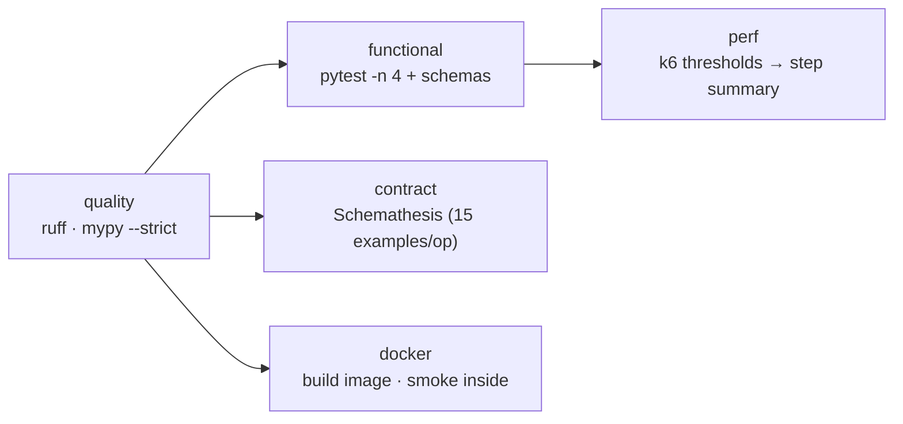

# api-quality-toolkit

[](https://github.com/yassineaitt/api-quality-toolkit/actions/workflows/ci.yml)
[](pyproject.toml)
[](tests)
[](tests/contract)
[](perf/k6/smoke.js)
[](LICENSE)

Three layers of API quality in one repository, each answering a different question, all
runnable with the same commands **locally, in Docker and in CI**:

| Layer      | Question it answers                                        | Tooling                                   | Target                          |
| ---------- | ---------------------------------------------------------- | ----------------------------------------- | ------------------------------- |
| Functional | Does each endpoint do what we expect, with the right shape? | `pytest` + `httpx` + JSON Schema 2020-12  | [restful-booker] sandbox        |
| Contract   | Does the live API honour its own OpenAPI document?          | `Schemathesis` (property-based)           | [Swagger Petstore] OpenAPI 3.0  |
| Performance| Is it fast and reliable enough under a small, steady load?  | `k6` with build-failing thresholds        | [restful-booker] sandbox        |

[restful-booker]: https://restful-booker.herokuapp.com/apidoc/index.html
[Swagger Petstore]: https://petstore3.swagger.io

## Run it

```bash
# local
make install && make test            # lint + functional + contract
make perf                            # k6 smoke (needs k6 on PATH)

# docker (no toolchain needed)
make docker-test                     # functional suite in the uv image
make docker-perf                     # k6 via grafana/k6

# ci: .github/workflows/ci.yml runs quality → functional → contract → perf → docker
```

Targets and budgets are environment variables with sane defaults (`.env.example`), so
pointing the whole toolkit at your own API is a one-line change:

```bash
API_BASE_URL=https://api.staging.example.com \
CONTRACT_SCHEMA_URL=https://api.staging.example.com/openapi.json \
CONTRACT_BASE_URL=https://api.staging.example.com make test
```

## Functional tests

- `src/api_quality_toolkit/client.py` is a thin `httpx` client: base URL, JSON headers and
  the service's token-cookie convention. It returns raw responses; tests own the assertions.
- Every response body goes through `assert_matches(body, "<schema>")`. Schemas live in
  `schemas/` (Draft 2020-12, `additionalProperties: false`, cross-file `$ref`s resolved
  offline through a `referencing` registry). A drift fails with the JSON path of every
  violation, not a stack trace.
- Data is created through a `create_booking` fixture that validates the create response and
  deletes everything it made at teardown, so the shared sandbox is left as found.
- Markers: `smoke` (critical path), `regression`, `destructive` (writes). `-n 4` by default.

## Contract tests

`tests/contract/test_openapi_contract.py` loads the OpenAPI document, keeps the read-only
operations, generates **positive** inputs per operation with Hypothesis and checks every
response for the four things a contract promises: a declared status code, a declared content
type, a body that validates against the response schema, and no 5xx.

The public Petstore currently breaks its own contract in three places (a 500 on
`/store/inventory`, a 500 instead of 404 for unknown users, plain text with a JSON
content type on `/user/login`). Those are **pinned, not hidden**: `known_gaps.py` lists
each one with evidence, the fuzzer skips them, and `test_known_gaps.py` keeps asserting the
correct behaviour as an expected failure. When the sandbox is fixed the test turns XPASS,
which is the signal to remove the entry.

## Performance smoke

`perf/k6/smoke.js` runs a constant-VU scenario against `/ping`, `GET /booking` and
`GET /booking/{id}` and encodes the SLOs as k6 thresholds:

| Threshold                           | Default           | Env var          |
| ----------------------------------- | ----------------- | ---------------- |
| `http_req_duration` p(95), global   | `< 1500 ms`       | `K6_P95_MS`      |
| per-endpoint p(95) (`ping`/`list`/`get`) | `< 1500 ms`  | `K6_P95_MS`      |
| `http_req_failed` rate              | `< 2 %` (aborts early) | `K6_ERROR_RATE` |
| `checks` (status + shape)           | `> 98 %`          | -                |
| `contract_errors` (custom rate)     | `< 1 %`           | -                |

A crossed threshold makes `k6` exit non-zero, which fails the `perf` job. The job also writes
a p(95)/error-rate table to the GitHub Actions step summary and uploads `k6-summary.json`.

## CI pipeline



Runs on push, pull request, manual dispatch and a weekly schedule (public sandboxes drift;
better to learn it on a Monday morning than during a release). JUnit XML from every job is
uploaded as an artifact, which is what a flaky-test dashboard consumes.

## Design notes

- **Schemas, not ad-hoc asserts.** `assert res.json()["bookingid"] > 0` catches one field;
  a schema catches the field you forgot to think about.
- **Positive-only fuzzing by default.** Negative-data rejection and RFC-level checks are
  valuable, but against a public demo API they measure the sandbox, not the contract.
  The full `schemathesis run` CLI is one command away when you own the server.
- **Thresholds live with the script.** Budgets are code-reviewed like everything else and
  overridable per environment without editing the script.
- **One image per tool.** The Python suite runs in a `uv` image; k6 runs in `grafana/k6`.
  Smaller images, no toolchain mixing, same commands via `make`.

## Project layout

```
src/api_quality_toolkit/   config.py · client.py · validation.py · data.py
schemas/                   booking · created-booking · booking-id-list · auth-token
tests/functional/          health · auth · booking_crud · negative
tests/contract/            test_openapi_contract.py · known_gaps.py · test_known_gaps.py
perf/k6/smoke.js           thresholds + custom metrics + JSON summary
Dockerfile · docker-compose.yml · Makefile · .github/workflows/ci.yml
```

## License

[MIT](LICENSE) © Yassine Ait Tamarmoucht
